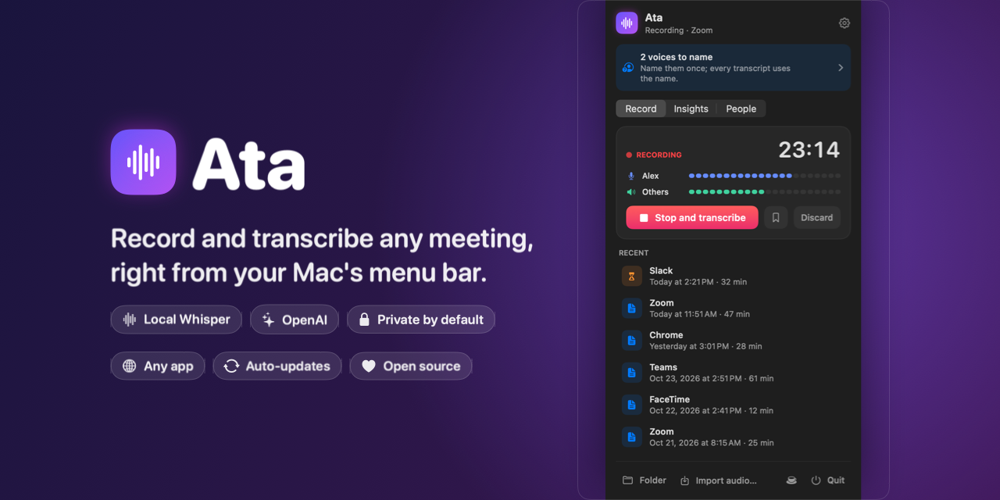
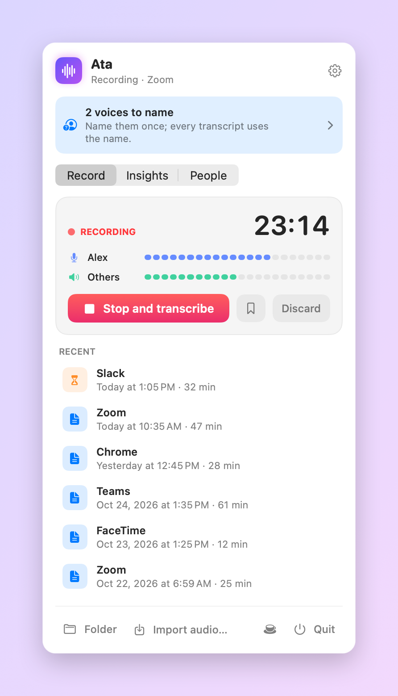
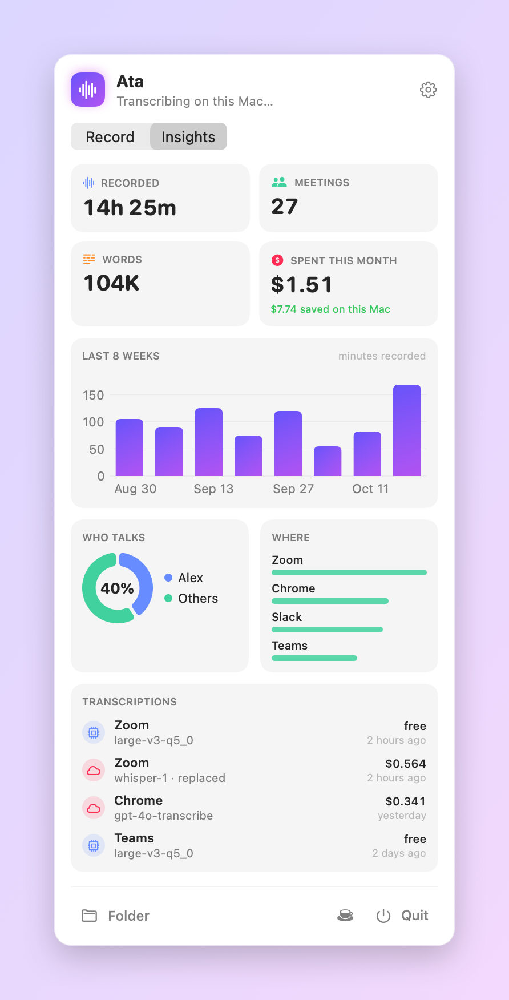
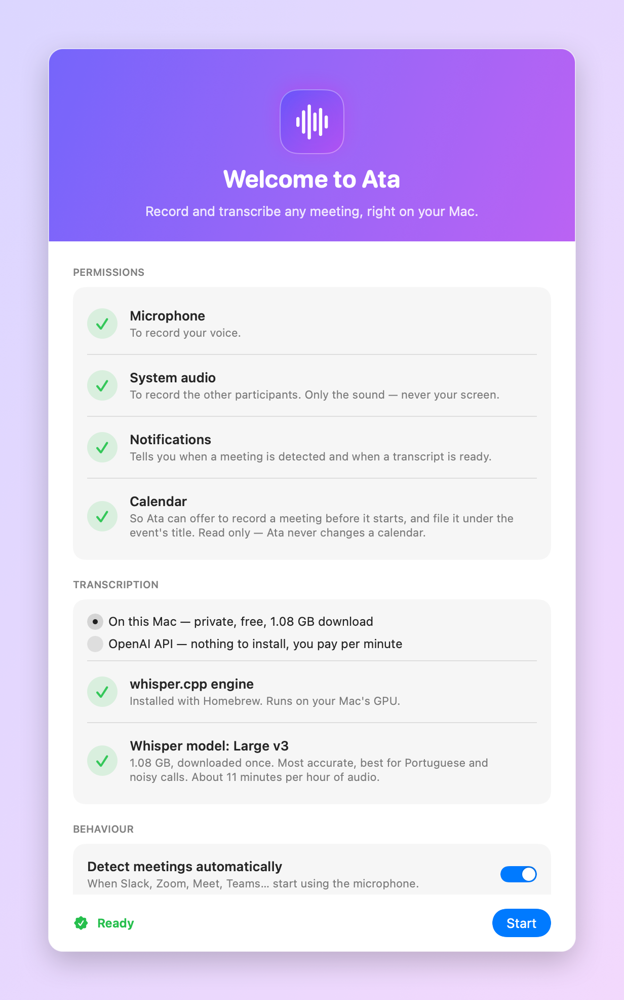
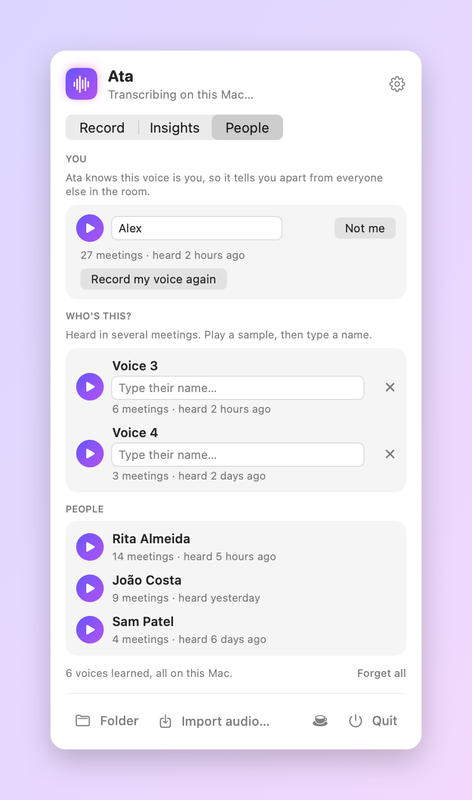
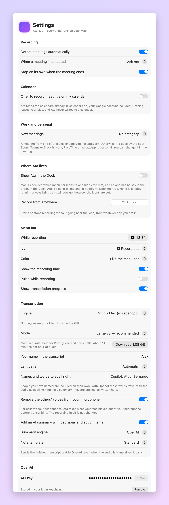

<div align="center">



<br>

[](https://github.com/mcpeixoto/Ata/actions/workflows/ci.yml)
[](https://github.com/mcpeixoto/Ata/releases/latest)


[](LICENSE)
[](https://buymeacoffee.com/mcpeixoto)

**Ata** is a tiny menu bar app that records your meetings — Slack, Zoom, Meet, Teams, FaceTime,
anything in the browser — and turns them into clean Markdown transcripts.
On your Mac with Whisper, or through the OpenAI API. Your call.

[**Download**](https://github.com/mcpeixoto/Ata/releases/latest) ·
[How it works](docs/ARCHITECTURE.md) ·
[Contributing](CONTRIBUTING.md) ·
[Changelog](CHANGELOG.md)

</div>

---

<table>
<tr>
<td width="50%" align="center">
<picture>
  <source media="(prefers-color-scheme: dark)" srcset="docs/images/menu-recording-dark.png">
  
</picture>
<br><sub><b>Mid-meeting.</b> Live levels for you and for everyone else, so you know both sides are being captured.</sub>
</td>
<td width="50%" align="center">
<picture>
  <source media="(prefers-color-scheme: dark)" srcset="docs/images/menu-insights-dark.png">
  
</picture>
<br><sub><b>Insights.</b> What you've recorded, who did the talking, and what each transcript cost.</sub>
</td>
</tr>
</table>

## Why Ata

- **Works with every meeting app.** It records your microphone and your Mac's own audio, so there's
  no bot joining the call and no per-app integration to break.
- **Private by default.** The default engine is whisper.cpp on your GPU — the audio never leaves
  your Mac. No account, no telemetry, no server.
- **Or zero setup.** Prefer not to download a 1.6 GB model? Paste an OpenAI key and you're done.
- **Notices the meeting for you.** When Zoom or Slack grabs the mic, Ata asks if it should record —
  or just starts, if you tell it to.
- **Summaries, if you want them.** Overview, decisions, action items and open questions, above the
  transcript.
- **Knows who said what.** Ata learns the voices in your meetings, on your Mac. Name a voice once
  and every transcript uses the name.
- **See your history.** An Insights tab charts hours recorded, who talks how much, where your
  meetings happen and what every transcript cost.
- **Change your mind later.** Re-transcribe any meeting with a different model; the old
  transcript is kept next to the new one.
- **Hard to lose a recording.** Survives switching microphones, sleep, crashes and power loss.
- **Plain files.** Every meeting is a folder with a `transcript.md` and the audio. Grep it, sync it,
  feed it to anything.

## Install

1. Download **`Ata-<version>.dmg`** from the [latest release](https://github.com/mcpeixoto/Ata/releases/latest).
2. Drag Ata into Applications and open it.
3. Grant the microphone and system-audio permissions in the welcome window, and pick an engine.

Ata asks for two permissions: the **microphone**, and **System Audio Recording Only** — the
sound your Mac plays, never your screen. Allow both once and Ata restarts itself to start using
them.

Releases are signed with a Developer ID and notarized by Apple, so they open without warnings — and
Ata keeps itself up to date from then on.

**Requirements:** macOS 14.2 Sonoma or later, Apple Silicon.

<details>
<summary><b>Build from source instead</b></summary>

```bash
git clone https://github.com/mcpeixoto/Ata.git
cd Ata
./install.sh
```

You need the Xcode Command Line Tools (`xcode-select --install`). The script builds the app,
installs it in `/Applications` and opens it. There's no Xcode project — it's a plain Swift package.

</details>

<p align="center">
<picture>
  <source media="(prefers-color-scheme: dark)" srcset="docs/images/onboarding-dark.png">
  
</picture>
</p>

## Two ways to transcribe

| | **On this Mac** (default) | **OpenAI API** |
|---|---|---|
| Where the audio goes | nowhere — it never leaves your Mac | uploaded to OpenAI |
| Cost | free | per minute of audio |
| Setup | whisper.cpp + a model (0.6–1.6 GB, your pick), installed for you from the welcome window | paste an API key |
| Speed | about 11 min per hour of audio with Large v3, 3 min with Turbo (M4) | depends on your connection |
| Timestamps | per line | per line with `whisper-1`; none with the `gpt-4o-transcribe` models |

Switch any time in **Settings → Transcription**, where you can also pick the local model —
from a small, fast one to the most accurate — and right-click any meeting to **transcribe it
again with a different model**. Earlier transcripts are kept in the meeting's `versions/`
folder. The **AI summary** works with either engine; it
always goes through OpenAI because it needs a language model, and it sends only the finished text.
Your API key lives in the login keychain — never in a file, never in a meeting folder.

## What you get

Each meeting lands in `~/Documents/Meetings/<date> <app>/`:

```
2026-10-20 14.02.11 Zoom/
├── transcript.md
├── meeting.mp3      ← the whole meeting in one file, to listen to or share
├── mic.m4a          ← you
├── system.m4a       ← everyone else
├── notes.md         ← your own notes, if you wrote any
├── meeting.json     ← times, app, and every transcription: model, minutes, cost
└── versions/        ← earlier transcripts, if you re-transcribed
```

```markdown
# Zoom — October 20, 2026 at 2:02 PM

Duration: 47 min · Participants: Alex, Others

## Summary

**Overview** — Agreed to ship the beta on the 3rd and move billing to the next sprint.
**Action items**
- Alex: send the beta invite list by Thursday

---

**[00:00] Alex:** Okay, I think everyone's here. Let's start with the launch date.

**[00:06] Others:** We're good for the third if billing slips a sprint.
```

**Audio is kept by default**, compressed to m4a — about a tenth of the raw size — so you can always
re-transcribe or listen back. Ata also mixes both tracks into one `meeting.mp3` (about 21 MB an
hour) that opens anywhere. Turn either off, or have Ata delete audio after 7, 30 or 90 days, in
**Settings → Audio**.

## Every meeting in its own window

Click a meeting in the menu to open it:

- **Listen** to the whole meeting, with ±15 s skips and 1×–2× speed, on a waveform of who spoke
  when: the others above, you below. Click any **word** of the transcript to jump to that
  moment; the word being said is highlighted as you listen.
- **Notes**: the AI summary, with the decisions and action items, written on your Mac by Apple
  Intelligence on macOS 26, or by OpenAI. No summary yet? **Write notes** creates one from the
  transcript text. Below it is space for your own notes, saved as `notes.md`.
- **Transcript**, searchable.
- **People**: every voice in this meeting, with a play button and a name field. Name a voice here
  even if Ata has only heard it once, and every transcript uses the name.
- **Share** the audio, the transcript or the notes through AirDrop, Mail, Messages or any app —
  named after the meeting — or drag the MP3 out of the player.
- Copy the transcript or notes, **Save as MP3…**, transcribe again with another model, or delete.

Meetings recorded before Ata 2.4 work the same way: their MP3 is made in the background after
the update, from whatever audio is still kept.

The menu bar icon while recording is yours to choose in **Settings → Menu bar**: a record dot,
a waveform, a microphone or Ata's glyph; in the menu bar's colour, red or your accent colour;
with or without the timer; pulsing or still.

## Who said what

<p align="center">
<picture>
  <source media="(prefers-color-scheme: dark)" srcset="docs/images/menu-people-dark.png">
  
</picture>
</p>

Turn on voice recognition in the **People** tab and Ata splits the other participants apart —
"Others" becomes Voice 1, Voice 2… — and learns each voice across meetings. Once it has heard
a voice in two meetings it asks who it is: play a few seconds, type a name. From then on that
person is named in every transcript, including the ones already written.

- Runs entirely on your Mac, on the Neural Engine, about 100× faster than real time.
- Voice fingerprints and samples never leave the Mac — not even when OpenAI transcribes.
- Off by default. Needs macOS 15. Downloads 21 MB of models the first time.

<details>
<summary><b>See every setting</b></summary>
<br>
<p align="center">
<picture>
  <source media="(prefers-color-scheme: dark)" srcset="docs/images/settings-dark.png">
  
</picture>
</p>
</details>

## Built to not lose your meeting

| When… | Ata… |
|---|---|
| you plug in AirPods mid-call | keeps recording into the same file |
| the microphone stops responding | restarts it on its own |
| your Mac sleeps, or system capture drops | reconnects |
| a track restarts mid-meeting | pads with silence so both tracks stay aligned |
| the app crashes or the battery dies | already has the audio on disk (header rewritten every 3 s) and transcribes it on next launch |
| you quit while recording | closes the files properly and transcribes when you're back |
| transcription fails | keeps the audio and shows **Try again** |
| you're not wearing headphones | takes the others out of your microphone before transcribing, using what your Mac played, so their words never come out as yours |
| two people talk in one Whisper segment | splits the line word by word at the change of speaker |

## Updates

Ata checks this repository's releases once a day and offers the update in the menu. Before anything
is swapped in, the download is verified with `codesign`, Gatekeeper is asked for its verdict, and
the Team ID must match the running app's — a tampered or re-signed download is refused, and your
working copy is put back if the install fails halfway.

## Privacy

With the local engine, Ata talks to the network only to download models once (Whisper, and the
voice-recognition models if you turn that on) and to ask the GitHub API for the latest release
once a day. That's it.

With the OpenAI engine, the recorded audio is sent to OpenAI's transcription endpoint, and the UI
says so wherever you choose it.

> **Always tell people you're recording.** The law differs by country — and it's the decent thing
> to do either way.

## Roadmap

Ideas with an issue attached are up for grabs — see
[good first issues](https://github.com/mcpeixoto/Ata/issues?q=is%3Aopen+label%3A%22good+first+issue%22).

- [x] Tell remote speakers apart ([#5](https://github.com/mcpeixoto/Ata/issues/5)) — 2.3
- [ ] Global keyboard shortcut to start and stop ([#2](https://github.com/mcpeixoto/Ata/issues/2))
- [ ] Subtitles (`.srt`) and plain text next to each transcript ([#3](https://github.com/mcpeixoto/Ata/issues/3))
- [ ] More languages — Spanish first ([#4](https://github.com/mcpeixoto/Ata/issues/4))
- [ ] A transcript window with search across meetings ([#6](https://github.com/mcpeixoto/Ata/issues/6)) — each meeting has its own window with search since 2.4; search across meetings is still to do

## Contributing

Bug reports, translations and pull requests are all welcome — [CONTRIBUTING.md](CONTRIBUTING.md)
has the five-minute setup, and [docs/ARCHITECTURE.md](docs/ARCHITECTURE.md) explains how the
pieces fit. Please read the [code of conduct](CODE_OF_CONDUCT.md) first, and report security issues
[privately](SECURITY.md).

## Credits

Ata stands on [whisper.cpp](https://github.com/ggerganov/whisper.cpp) by Georgi Gerganov and
contributors, OpenAI's [Whisper](https://github.com/openai/whisper) models, and
[FluidAudio](https://github.com/FluidInference/FluidAudio) by FluidInference with its
pyannote and WeSpeaker speaker models, and the [LAME](https://lame.sourceforge.io) MP3 encoder.
Licences are listed in [NOTICE](NOTICE).

## License

[MIT](LICENSE) © Miguel Peixoto

<p align="center">
If Ata saved you from taking notes, <a href="https://buymeacoffee.com/mcpeixoto">buy me a coffee</a> ☕
</p>
