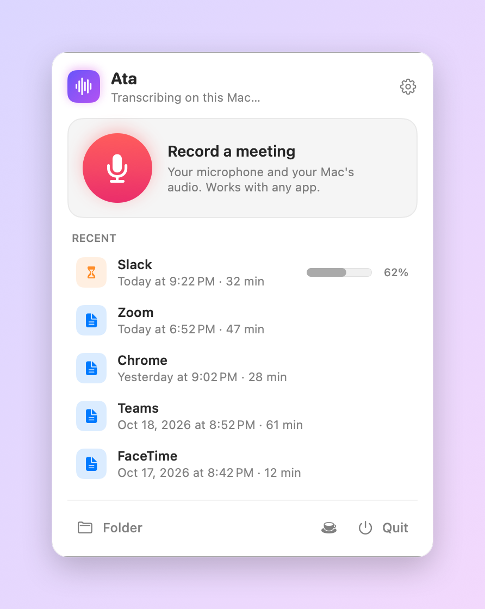

<div align="center">


<br>

[](https://github.com/mcpeixoto/Ata/actions/workflows/ci.yml)
[](https://github.com/mcpeixoto/Ata/releases/latest)


[](LICENSE)
[](https://buymeacoffee.com/mcpeixoto)

**Ata** is a tiny menu bar app that records your meetings — Slack, Zoom, Meet, Teams, FaceTime,
anything in the browser — and turns them into clean Markdown transcripts.
On your Mac with Whisper, or through the OpenAI API. Your call.

[**Download**](https://github.com/mcpeixoto/Ata/releases/latest) ·
[How it works](docs/ARCHITECTURE.md) ·
[Contributing](CONTRIBUTING.md) ·
[Changelog](CHANGELOG.md)

</div>

---

<table>
<tr>
<td width="50%" align="center">
<picture>
  <source media="(prefers-color-scheme: dark)" srcset="docs/images/menu-recording-dark.png">
  
</picture>
<br><sub><b>Mid-meeting.</b> Live levels for you and for everyone else, so you know both sides are being captured.</sub>
</td>
<td width="50%" align="center">
<picture>
  <source media="(prefers-color-scheme: dark)" srcset="docs/images/menu-idle-dark.png">
  
</picture>
<br><sub><b>After.</b> Transcription runs in the background; recent meetings are one click away.</sub>
</td>
</tr>
</table>

## Why Ata

- **Works with every meeting app.** It records your microphone and your Mac's own audio, so there's
  no bot joining the call and no per-app integration to break.
- **Private by default.** The default engine is whisper.cpp on your GPU — the audio never leaves
  your Mac. No account, no telemetry, no server.
- **Or zero setup.** Prefer not to download a 1.6 GB model? Paste an OpenAI key and you're done.
- **Notices the meeting for you.** When Zoom or Slack grabs the mic, Ata asks if it should record —
  or just starts, if you tell it to.
- **Summaries, if you want them.** Overview, decisions, action items and open questions, above the
  transcript.
- **Hard to lose a recording.** Survives switching microphones, sleep, crashes and power loss.
- **Plain files.** Every meeting is a folder with a `transcript.md` and the audio. Grep it, sync it,
  feed it to anything.

## Install

1. Download **`Ata-<version>.dmg`** from the [latest release](https://github.com/mcpeixoto/Ata/releases/latest).
2. Drag Ata into Applications and open it.
3. Grant the microphone and system-audio permissions in the welcome window, and pick an engine.

Releases are signed with a Developer ID and notarized by Apple, so they open without warnings — and
Ata keeps itself up to date from then on.

**Requirements:** macOS 14 Sonoma or later, Apple Silicon.

<details>
<summary><b>Build from source instead</b></summary>

```bash
git clone https://github.com/mcpeixoto/Ata.git
cd Ata
./install.sh
```

You need the Xcode Command Line Tools (`xcode-select --install`). The script builds the app,
installs it in `/Applications` and opens it. There's no Xcode project — it's a plain Swift package.

</details>

<p align="center">
<picture>
  <source media="(prefers-color-scheme: dark)" srcset="docs/images/onboarding-dark.png">
  
</picture>
</p>

## Two ways to transcribe

| | **On this Mac** (default) | **OpenAI API** |
|---|---|---|
| Where the audio goes | nowhere — it never leaves your Mac | uploaded to OpenAI |
| Cost | free | per minute of audio |
| Setup | whisper.cpp + a 1.6 GB model, installed for you from the welcome window | paste an API key |
| Speed | fast on Apple Silicon (Metal) | depends on your connection |
| Timestamps | per line | per line with `whisper-1`; none with the `gpt-4o-transcribe` models |

Switch any time in **Settings → Transcription**. The **AI summary** works with either engine; it
always goes through OpenAI because it needs a language model, and it sends only the finished text.
Your API key lives in the login keychain — never in a file, never in a meeting folder.

## What you get

Each meeting lands in `~/Documents/Meetings/<date> <app>/`:

```
2026-10-20 14.02.11 Zoom/
├── transcript.md
├── mic.m4a          ← you
├── system.m4a       ← everyone else
└── meeting.json
```

```markdown
# Zoom — October 20, 2026 at 2:02 PM

Duration: 47 min · Participants: Alex, Others

## Summary

**Overview** — Agreed to ship the beta on the 3rd and move billing to the next sprint.
**Action items**
- Alex: send the beta invite list by Thursday

---

**[00:00] Alex:** Okay, I think everyone's here. Let's start with the launch date.

**[00:06] Others:** We're good for the third if billing slips a sprint.
```

**Audio is kept by default**, compressed to m4a — about a tenth of the raw size — so you can always
re-transcribe or listen back. Turn that off, or have Ata delete audio after 7, 30 or 90 days, in
**Settings → Audio**.

<details>
<summary><b>See every setting</b></summary>
<br>
<p align="center">
<picture>
  <source media="(prefers-color-scheme: dark)" srcset="docs/images/settings-dark.png">
  
</picture>
</p>
</details>

## Built to not lose your meeting

| When… | Ata… |
|---|---|
| you plug in AirPods mid-call | keeps recording into the same file |
| the microphone stops responding | restarts it on its own |
| your Mac sleeps, or system capture drops | reconnects |
| a track restarts mid-meeting | pads with silence so both tracks stay aligned |
| the app crashes or the battery dies | already has the audio on disk (header rewritten every 3 s) and transcribes it on next launch |
| you quit while recording | closes the files properly and transcribes when you're back |
| transcription fails | keeps the audio and shows **Try again** |
| you're not wearing headphones | drops the lines your mic picked up as echo of the others |

## Updates

Ata checks this repository's releases once a day and offers the update in the menu. Before anything
is swapped in, the download is verified with `codesign`, Gatekeeper is asked for its verdict, and
the Team ID must match the running app's — a tampered or re-signed download is refused, and your
working copy is put back if the install fails halfway.

## Privacy

With the local engine, Ata talks to the network twice: to download the model once, and to ask the
GitHub API for the latest release once a day. That's it.

With the OpenAI engine, the recorded audio is sent to OpenAI's transcription endpoint, and the UI
says so wherever you choose it.

> **Always tell people you're recording.** The law differs by country — and it's the decent thing
> to do either way.

## Roadmap

Ideas with an issue attached are up for grabs — see
[good first issues](https://github.com/mcpeixoto/Ata/issues?q=is%3Aopen+label%3A%22good+first+issue%22).

- [ ] Tell remote speakers apart ("Others" is everyone together today)
- [ ] Global keyboard shortcut to start and stop
- [ ] More UI languages (English and Portuguese today)
- [ ] Export to `.txt`, `.srt` and `.docx`
- [ ] A transcript viewer with search across meetings

## Contributing

Bug reports, translations and pull requests are all welcome — [CONTRIBUTING.md](CONTRIBUTING.md)
has the five-minute setup, and [docs/ARCHITECTURE.md](docs/ARCHITECTURE.md) explains how the
pieces fit. Please read the [code of conduct](CODE_OF_CONDUCT.md) first, and report security issues
[privately](SECURITY.md).

## Credits

Ata stands on [whisper.cpp](https://github.com/ggerganov/whisper.cpp) by Georgi Gerganov and
contributors, and on OpenAI's [Whisper](https://github.com/openai/whisper) models.

## License

[MIT](LICENSE) © Miguel Peixoto

<p align="center">
If Ata saved you from taking notes, <a href="https://buymeacoffee.com/mcpeixoto">buy me a coffee</a> ☕
</p>
