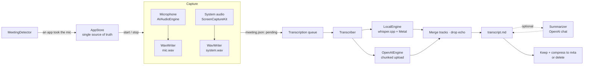

# How Ata works

Ata is a SwiftUI menu bar app (`LSUIElement`) built as a plain Swift package: no Xcode project,
no third-party dependencies. This page walks through a meeting from the first sound to the
finished `transcript.md`.

## 1. Noticing a meeting — `MeetingDetector`

Every two seconds Ata asks Core Audio's process list (macOS 14+) which processes are capturing
from an input device. When another app — Zoom, Slack, Teams, a browser tab on Meet, FaceTime… —
has held the microphone for about four seconds, `AppStore` either posts a notification with a
**Record** button or starts recording on its own, depending on Settings.

The meeting counts as over once nobody has used the microphone for about sixteen seconds. Even
then, an automatic stop waits until the system audio has also been quiet for ten seconds, so
muting yourself doesn't end the recording.

## 2. Capturing two tracks — `Recorder` and `WavWriter`

The microphone (via `AVAudioEngine`) and the Mac's output (via ScreenCaptureKit, audio only) are
recorded as **two separate 16 kHz mono WAV files**. Keeping them apart is what lets the transcript
say who spoke — "you" or "the others" — without any speaker-recognition model.

`WavWriter` is built to never lose a recording:

- it converts whatever format arrives, and builds a new converter if the format changes mid-stream
  (you plugged in AirPods);
- it pads gaps with silence using the host clock, so the two tracks stay aligned even after a
  restart;
- it rewrites the WAV header every three seconds, so a crash or power cut leaves a playable file.
  On the next launch `AppStore` repairs the header and queues the meeting.

`Recorder` restarts the microphone when the device changes, when it stops delivering buffers, and
after the Mac wakes from sleep.

## 3. The queue — `AppStore`

Every meeting is a folder with a `meeting.json` whose `status` moves through
`recording → pending → transcribing → done | failed`. The queue transcribes one meeting at a
time, oldest first. Because state lives on disk, a crash at any point resumes cleanly: a meeting
caught mid-transcription goes back to `pending`.

The options for a job — engine, model, language, your name, whether to summarize — are captured
when the job starts, so changing a setting mid-run can't produce a transcript that mixes two
configurations.

## 4. Transcribing — `Transcriber`, `LocalEngine`, `OpenAIEngine`

`Transcriber` runs each track through the selected engine:

- **`LocalEngine`** runs `whisper-cli` (from Homebrew's `whisper-cpp`) with the large-v3-turbo
  model and, when available, Silero VAD. It reads progress from whisper's stderr and the segments
  from its JSON output.
- **`OpenAIEngine`** splits each WAV into ten-minute pieces — a byte-range copy plus a new header,
  no re-encoding — to stay under OpenAI's 25 MB upload limit, uploads them, and shifts every
  segment's timestamps by its piece's offset.

Then it merges both tracks into one timeline, and **removes echo**: without headphones your
microphone hears the other participants, so the same sentence appears twice. Microphone segments
that overlap in time with an "others" segment and share most of its words are dropped. This needs
real timestamps, so it's skipped for OpenAI models that don't return them.

Finally it writes `transcript.md`. If summaries are on, `Summarizer` sends the finished text to
OpenAI's chat API and the summary goes above the transcript. The transcript is already on disk at
that point, so a failed summary costs nothing.

## 5. Afterwards — audio handling

On success, the audio is kept and compressed to AAC in an m4a container (about ten times smaller),
or deleted, depending on Settings. On failure it is **always** kept, and the meeting shows
**Try again**. Re-transcribing a compressed meeting decodes the m4a back into the WAV shape
whisper.cpp expects.

## 6. Updates — `Updater`

Once a day `Updater` asks the GitHub API for the latest release of the repository named in
`Info.plist` (`AtaRepository`). If it's newer, the menu offers it. Installing downloads the
release zip, then refuses to continue unless:

1. `codesign --verify --deep --strict` passes,
2. Gatekeeper accepts it as notarized (`spctl -a -t install`), and
3. its Team ID equals the running app's.

Only then is the running bundle moved aside, the new one copied in, and the app relaunched. If the
copy fails, the original is put back.

## Where things live

| Path | What |
|---|---|
| `~/Documents/Meetings/` | one folder per meeting (override with `ATA_MEETINGS_DIR`) |
| `~/Library/Application Support/Ata/models/` | the Whisper and VAD models |
| login keychain, service `ai.interactive.ata` | the OpenAI API key |
| `UserDefaults` (`ai.interactive.ata`) | settings |

## Building and shipping

`scripts/build-app.sh` assembles the bundle — binary, `Info.plist`, icon, `.lproj` folders — and
signs it, ad hoc for local builds or with a Developer ID for releases. CI and the release workflow
call the same script. Pushing a `v*` tag runs `.github/workflows/release.yml`, which signs,
notarizes, staples and publishes the DMG and the zip the updater reads.
