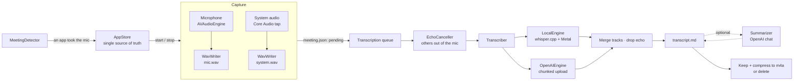

# How Ata works

Ata is a SwiftUI menu bar app (`LSUIElement`) built as a plain Swift package: no Xcode project,
and two dependencies: FluidAudio, for on-device speaker recognition, and LAME, vendored in
`Sources/CLame`, to write MP3. This page walks through a meeting from the first sound to the
finished `transcript.md`.

## 1. Noticing a meeting — `MeetingDetector`

Every two seconds Ata asks Core Audio's process list (macOS 14+) which processes are capturing
from an input device. When another app — Zoom, Slack, Teams, a browser tab on Meet, FaceTime… —
has held the microphone for about four seconds, `AppStore` either posts a notification with a
**Record** button or starts recording on its own, depending on Settings.

The meeting counts as over once nobody has used the microphone for about sixteen seconds. Even
then, an automatic stop waits until the system audio has also been quiet for ten seconds, so
muting yourself doesn't end the recording.

## 2. Capturing two tracks — `Recorder` and `WavWriter`

The microphone (via `AVAudioEngine`) and the Mac's output (via a Core Audio process tap) are
recorded as **two separate 16 kHz mono WAV files**. Keeping them apart is what lets the transcript
say who spoke — "you" or "the others" — without any speaker-recognition model.

`WavWriter` is built to never lose a recording:

- it converts whatever format arrives, and builds a new converter if the format changes mid-stream
  (you plugged in AirPods);
- it pads gaps with silence using the host clock, so the two tracks stay aligned even after a
  restart;
- it rewrites the WAV header every three seconds, so a crash or power cut leaves a playable file.
  On the next launch `AppStore` repairs the header and queues the meeting.

`Recorder` restarts the microphone when the device changes, when it stops delivering buffers, and
after the Mac wakes from sleep.

**System audio** is a global Core Audio process tap (macOS 14.2+), excluding Ata's own sound,
inside a private aggregate device clocked by the current output device; it is rebuilt when the
output device changes. It needs only the audio-only "System Audio Recording Only" permission —
not Screen Recording, which ScreenCaptureKit (used until 2.3.0) required, and which macOS only
reported as granted after a relaunch, so the welcome window kept asking for it.

Apple has no public API to read that permission. `SystemAudioPermission` uses the TCC
framework's own entry points, loaded at runtime, and falls back to the system's prompt on first
capture if they ever disappear. Two measured facts shape the flow: a tap started before the
user answers delivers nothing, so Ata asks first; and a grant only takes effect for a process
started after it, so Ata restarts itself once, when idle, right after the grant.
`Ata --diagnose` prints both permissions and records five seconds of each track.

## 3. The queue — `AppStore`

Every meeting is a folder with a `meeting.json` whose `status` moves through
`recording → pending → transcribing → done | failed`. The queue transcribes one meeting at a
time, oldest first. Because state lives on disk, a crash at any point resumes cleanly: a meeting
caught mid-transcription goes back to `pending`.

The options for a job — engine, model, language, your name, whether to summarize — are captured
when the job starts, so changing a setting mid-run can't produce a transcript that mixes two
configurations.

## 4. Transcribing — `Transcriber`, `LocalEngine`, `OpenAIEngine`

First, **`EchoCanceller`** cleans a copy of the microphone track. Without headphones the
microphone hears the other participants through the speakers, and their words used to come out a
second time, as yours. The system track is exactly what the speakers played, so the echo can be
predicted and removed. The steps:
- **Clock drift:** measured on 10 s chunks with GCC-PHAT and fitted robustly. It's undone by
  resampling the reference, and only kept if it removes more echo.
- **Echo path:** every 10 s, the delay is found from the two energy envelopes. Then, for each
  frequency, a 12-tap least-squares estimate of the path from speaker to microphone is subtracted.
- **Leftovers:** a residual suppressor takes care of what's left, and frames that hold nothing
  but echo are silenced.

With headphones, the envelopes don't correlate, and the microphone is used exactly as recorded.
The recording itself is never changed. Tuning was done on a Python reference with real speech:
echo went from 0 to 31–36 dB down while only the others spoke, and your speech was untouched.
The cleaned copy is then what gets transcribed and what your voice fingerprint is learned from.

`Transcriber` runs each track through the selected engine:

- **Several languages in one voice.** With the language set to Automatic and more than one
  language on the Mac, `LocalEngine.transcribeMixed` handles each track as follows:
  - `SpeechChunks` cuts it at pauses (4–30 s pieces);
  - one whisper-cli run detects every piece's language, loading the model once for all the
    `-f` files;
  - `LanguageChoice.runs` keeps a language only when it's sure (p ≥ 0.8, a language the user
    speaks, at least 3 s). Anything else takes its neighbour's language, so a stray "okay"
    isn't a switch;
  - each run of one language is transcribed in that language and shifted back into place.
  - A track in one language is a single run, as before. whisper.cpp's own `auto` decides once
    per file, from the first 30 s, so it can't follow a switch.

- **`LocalEngine`** runs `whisper-cli` (from Homebrew's `whisper-cpp`) with the large-v3-turbo
  model and, when available, Silero VAD. It reads progress from whisper's stderr and the segments
  from its JSON output.
- **`OpenAIEngine`** splits each WAV into ten-minute pieces — a byte-range copy plus a new header,
  no re-encoding — to stay under OpenAI's 25 MB upload limit, uploads them, and shifts every
  segment's timestamps by its piece's offset.

Then it merges both tracks into one timeline, and drops any echo that survived as text: microphone
segments that overlap in time with an "others" segment and share most of its words. This needs
real timestamps, so it's skipped for OpenAI models that don't return them. Since 2.4.1 it's the
second line of defence; `EchoCanceller` is the first.

Finally it writes `transcript.md`. If summaries are on, `Summarizer` sends the finished text to
OpenAI's chat API and the summary goes above the transcript. The transcript is already on disk at
that point, so a failed summary costs nothing.

## 5. Afterwards — audio handling

As soon as a recording stops, `MergedAudio` mixes the two tracks into `meeting.mp3` (mono,
16 kHz, 48 kbps, encoded by LAME) in the background, so the meeting can be heard before it is
transcribed. The MP3 is written to a `.partial` file and moved into place only when complete, and
it never replaces the tracks: transcribing again and voice recognition need them apart.

On success, the audio is kept and compressed to AAC in an m4a container (about ten times smaller),
or deleted, depending on Settings. `handleAudio` waits for the MP3 first, so the tracks are never
compressed out from under it. On failure the audio is **always** kept, and the meeting shows
**Try again**. Re-transcribing a compressed meeting decodes the m4a back into the WAV shape
whisper.cpp expects (`PCM16Reader`, shared with the MP3 mix).

## 5¼. The meeting window — `MeetingView`, `MeetingModel`

Clicking a meeting opens `WindowManager.showMeeting`, one window per meeting. `MeetingModel` reads
the folder (`meeting.json`, `transcript.json`, `speakers.json`, `notes.md`) and reads it again
whenever the history or a voice's name changes. `MeetingPlayer` plays `meeting.mp3`, or both
tracks laid over each other in an `AVMutableComposition` when there's no MP3 yet. **Write notes**
summarizes an already-transcribed meeting through `Summarizer`, stores the summary in
`transcript.json`, re-renders `transcript.md`, and adds the cost to the latest transcription.
Naming a voice there goes through `PeopleModel.rename`, like the People tab.

Sharing hands the share sheet copies named after the meeting (`MeetingSharing`), in a temporary
folder emptied at the next launch — a share extension may still be reading after the window
closes. A meeting without `meeting.mp3` is mixed straight into the share copy. At launch,
`backfillMergedAudio` gives every older meeting that still has its tracks a `meeting.mp3`, one at
a time.

## 5½. Who said what — `Diarization`, `Voices`, `PeopleModel`

With voice recognition on (off by default; macOS 15+), after the tracks are transcribed:

1. FluidAudio diarizes the system track on Core ML — pyannote segmentation, WeSpeaker
   embeddings, VBx clustering — into speaker turns, and gives one 256-dimension voice
   fingerprint per speaker. Speakers with under 10 s of speech are labelled but not learned.
2. Each "others" line is split word by word at the turns (Whisper's own segments run across
   speakers). A change that lands mid-phrase moves to the nearest sentence end or clear pause,
   because Whisper's word times lag the audio by a few hundred milliseconds.
3. The mic track is fingerprinted as "me".
4. Each fingerprint is matched against the voice library: cosine ≥ 0.65 *and* a 0.1 lead over the
   runner-up, otherwise it's a new voice with a permanent number ("Voice 3"). Measured: the same
   voice 0.95–0.96 across recordings (0.82–0.85 over phone-quality audio), different voices
   0.02–0.49.
5. `speakers.json` (turns and voices) and `transcript.json` (labelled lines) go in the meeting
   folder; a few seconds of each new voice are cut as a sample for the People tab.

Naming, merging or forgetting a voice re-renders every affected `transcript.md` from its
`transcript.json` — no re-transcription, no new version. The library lives in
`~/Library/Application Support/Ata/voices/` and never leaves the Mac.

## 6. Updates — `Updater`

Once a day `Updater` asks the GitHub API for the latest release of the repository named in
`Info.plist` (`AtaRepository`). If it's newer, the menu offers it. Installing downloads the
release zip, then refuses to continue unless:

1. `codesign --verify --deep --strict` passes,
2. Gatekeeper accepts it as notarized (`spctl -a -t install`), and
3. its Team ID equals the running app's.

Only then is the running bundle moved aside, the new one copied in, and the app relaunched. If the
copy fails, the original is put back.

## Where things live

| Path | What |
|---|---|
| `~/Documents/Meetings/` | one folder per meeting (override with `ATA_MEETINGS_DIR`) |
| `~/Library/Application Support/Ata/models/` | the Whisper and VAD models |
| login keychain, service `ai.interactive.ata` | the OpenAI API key |
| `~/Library/Application Support/Ata/voices/` | voice fingerprints and samples (override with `ATA_SUPPORT_DIR`) |
| `~/Library/Application Support/FluidAudio/` | the speaker-recognition models |
| `<meeting>/meeting.mp3`, `<meeting>/notes.md` | the mixed meeting audio, and your own notes |
| `UserDefaults` (`ai.interactive.ata`) | settings |

## Building and shipping

`scripts/build-app.sh` assembles the bundle — binary, `Info.plist`, icon, `.lproj` folders — and
signs it, ad hoc for local builds or with a Developer ID for releases. CI and the release workflow
call the same script. Pushing a `v*` tag runs `.github/workflows/release.yml`, which signs,
notarizes, staples and publishes the DMG and the zip the updater reads.
